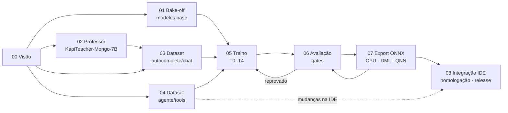

# KapiCoder-Mongo — plano de treinamento

Plano completo para treinar a família de modelos locais (ONNX) do **Kapibara Studio**: autocomplete contextual de MongoDB, chat curto e um agente local com raciocínio (thinking) e as ferramentas da IDE — oferecido no painel **Agente IA** ao lado do Claude CLI —, usando como professor o **Qwen2.5-Coder-7B Base** (escolhido no bake-off de 2026-10-09: o 14B não coube no QLoRA local; o DeepSeek-Coder 6.7B base fica só como referência).

> Elaborado em 08/10/2026 por um orquestrador e cinco agentes especialistas (seleção de modelos; professor + dados; agente/tools; treino + avaliação; ONNX/NPU + integração), a partir do pipeline v1 (`C:\IA\models\SlopStudio.MongoAI-Compact`) e do código atual da IDE (`F:\source\esilva-silva\EsilvaSoft.KapibaraStudio`, somente leitura). Cada documento marca o que é **fato verificado** e o que é **hipótese/proposta**.

## Fases

| # | Documento | Pergunta que responde | Estimativa |
|---|---|---|---|
| 00 | [Visão e premissas](fase-00-visao-premissas.md) | O que vamos entregar e o que aprendemos na v1? | — |
| 01 | [Seleção dos modelos base](fase-01-selecao-modelos-base.md) | Qual base em cada tier? (bake-off + piloto de destilação + raciocínio ligado×desligado) | 10–13 dias úteis |
| 02 | [Professor](fase-02-professor.md) | Como transformar o Qwen2.5-Coder-7B em KapiTeacher-Mongo-7B e como ele ensina (sequence-level + KD por logits)? | 12–15 dias úteis · ~95–115 h GPU (7B a 309–360 tok/s medidos) |
| 03 | [Dataset autocomplete e validação](fase-03-dataset-autocomplete-validacao.md) | Que material treina e valida autocomplete/chat? | 22–27 dias úteis |
| 04 | [Dataset agente e tools](fase-04-dataset-agente-tools.md) | Como ensinar as ferramentas do Kapibara, com traços de raciocínio? | ~51 pessoa-dia · ~66 h GPU |
| 05 | [Treinamento](fase-05-treinamento.md) | Receitas por tier (SFT, KD, tool calling, raciocínio, preferência, QAT) | **calendário único da GPU (§9)**: ~500–540 h com o professor 7B (cenário 7B da §9 + ~1,5× nas horas de CPT/SFT do professor, pela vazão medida), 100% local |
| 06 | [Avaliação e benchmarks](fase-06-avaliacao-benchmarks.md) | Como provar que o modelo é melhor e rápido o bastante? | contínua |
| 07 | [Exportação ONNX](fase-07-exportacao-onnx.md) | CPU, DirectML, QNN/NPU: como empacotar? (T4 16k ≈ 9–11 GB VRAM) | 3,5–5,5 semanas |
| 08 | [Integração no Kapibara](fase-08-integracao-kapibara.md) | Agente local no painel Agente IA (raciocínio, tools), homologação e release | 8–11 semanas |

Registros de decisão citados pelas fases como "briefing": [_briefing-agentes.md](_briefing-agentes.md) (premissas iniciais dos agentes) e [_briefing-troca-professor.md](_briefing-troca-professor.md) (troca do professor para Qwen2.5-Coder 14B/7B e estrutura `BaseRepos\`/`Repos\`, 2026-10-08b).

## Documentos de apoio

| Documento | Conteúdo |
|---|---|
| [Ajustes no Kapibara Studio](kapibara-studio-ajustes.md) | Backlog consolidado de 78 mudanças na IDE (P0 por tier, ordem de PRs, ADRs 070–076, decisões D1–D6). T0/T1/T2 não exigem mudança P0; T4 e T3 sim |
| [Prontidão para gerar os datasets](analise-prontidao-datasets.md) | Análise do checkout `0dbb4dd` da IDE (2026-10-10): o que já existe (KapiLab, agente Qwen3) e o que ainda falta, por dataset, com a ordem dos PRs |
| [KapiLab — console de amostras e testes](kapilab-console.md) | Especificação do `kapilab.exe` (.NET, em `tools\KapiLab\` da IDE): renderiza/tokeniza no contrato exato da IDE, exporta o catálogo de tools, gera amostras, valida e roda modelos, benchmark de latência, agente e smoke de NPU |

## Tiers e escolhas (provisórias até o bake-off da Fase 01)

| Tier | Base primária | Alternativa | Alvos ONNX |
|---|---|---|---|
| T0 Nano | Qwen2.5-Coder-0.5B Base, com KD por logits do KapiTeacher | — | CPU INT4/INT8, DML FP16 |
| T1 Small | Qwen2.5-Coder-1.5B Base, com KD por logits do KapiTeacher | — | CPU INT8, DML FP16/INT4 |
| T2 Pro | **KapiTeacher-Mongo-7B** (professor escolhido no J03b em 2026-10-09; adapter `qwen2` já existe na IDE) | — (14B reprovou na sonda: não coube com micro-batch ≥ 4k) | DML INT4 (~5 GB) |
| T3 NPU | pesos do T0 (0.5B) primeiro; o 1.5B do T1 só se passar latência e memória no Vivobook | — | QNN w4a16 (Olive, `htp_arch` 73, EPContext gerado para o X1-26-100) |
| T4 Agent | Qwen3-8B híbrido, raciocínio ligado por padrão (orçamento 1.024, máx. 4.096 tokens), contexto 16k | Qwen3-4B-Thinking-2507 (só pensa); fallback sem raciocínio Qwen2.5-Coder-7B-Instruct; Agent-Lite Qwen3-0.6B na NPU (sem raciocínio) / Qwen3-1.7B na CPU ARM64 INT4 (raciocínio curto) | DML INT4; QNN/CPU ARM64 para Lite |

## Fluxo e dependências

## Cronograma sugerido (1 pessoa + RX 7800 XT, 100% local)

| Semanas | Trabalho principal | Em paralelo |
|---|---|---|
| 1–2 | Fase 01 bake-off; contratos extraídos da IDE; fixtures no MongoDB do WSL | Fase 02 verificação e baseline do professor |
| 3–6 | Fase 03 geradores + validação; Fase 02 CPT/SFT do professor (GPU) | Fase 04 extração do catálogo de tools e simulador |
| 7–9 | Fase 03 destilação pelo professor; Fase 04 trajetórias | Fase 08 ADRs e mudanças na IDE (agente local, EPs) |
| 10–13 | Fase 05 T0/T1 (+ piloto KD) → Fase 06 → Fase 07 CPU/DML; **T4 em bloco contínuo de 3–4 dias (S10–S11)** | T2 = avaliação/export do KapiTeacher |
| 14–17 | Fase 07 NPU (Vivobook X1-26-100; S-NPU-0 já na semana 1); Fase 08 homologação | Release T0/T1 → T2 → T4 → T3 |

Calendário detalhado da GPU (jobs J01–J33, opcionais, ordem de corte, retomada, disco em E:): [Fase 05 §9](fase-05-treinamento.md). A GPU fica ocupada ~S1–S14 (~28–30 dias de GPU a ~19 h/dia com o 14B; S1–S13 com o 7B); o caminho crítico é o trabalho humano, exceto o bloco contínuo do T4.

Entrega incremental: **T0/T1 primeiro** (menor risco, adapter `qwen2` já existe), depois T2, T4 (exige mudanças na IDE) e T3 (homologado no notebook Snapdragon X de 16 GB).

## Bloqueios e decisões em aberto

| Item | Impacto | Onde |
|---|---|---|
| Hardware NPU: **ASUS Vivobook 16 X1607QA, Snapdragon X X1-26-100**, 16 GB compartilhados, Windows 11 Home. NPU Hexagon 45 TOPS igual à X Elite, mas o chip **não consta na lista oficial do QNN EP do Windows ML** (só X1E/X1P) e o `soc_model` dele não é público → suporte **provável, não oficial** | Spike **S-NPU-0** na semana 1 (inventário, registro do EP, LLM de controle). Orçamento ~3 GB para o modelo: T3 0.5B/1.5B e Agent-Lite 0.6B cabem; 1.7B só em CPU; MongoDB remoto ou `cacheSizeGB: 0.5` | [07 §5.5.1](fase-07-exportacao-onnx.md), [08](fase-08-integracao-kapibara.md) |
| `LocalAgentProvider` não faz tool calling e a ADR-068 só expõe o Copilot como agente em Release | T4 exige nova ADR, template de chat, parser de tool call e caminho de permissão Local | [04](fase-04-dataset-agente-tools.md), [08](fase-08-integracao-kapibara.md) |
| IDE em ORT GenAI 0.15.2 (atual 0.17.1); não registra EPs do Windows ML | NPU e prefix cache dependem de upgrade | [07](fase-07-exportacao-onnx.md), [08](fase-08-integracao-kapibara.md) |
| ~~Volume de treino~~ — **resolvido** para o orçamento local: T0 160k ex. (~62 M tok/época, 2 épocas), T1 230k (~100 M, 2 épocas), T4 8.000 trajetórias verificadas (mín. 6.000, ~80 M, 1 época), Agent-Lite 12k (~30 M), SFT do professor ~105k | — | [03](fase-03-dataset-autocomplete-validacao.md), [04](fase-04-dataset-agente-tools.md), [05 §8–9](fase-05-treinamento.md) |
| ~~Contexto de treino do T4~~ — **resolvido**: 16k em treino, export e metadata (p95 das trajetórias com raciocínio ≤ 13k) | Nenhum truncamento | [04](fase-04-dataset-agente-tools.md), [05](fase-05-treinamento.md), [07](fase-07-exportacao-onnx.md) |
| Gates divergentes: agente (Fase 04 §10.2 × Fase 06 §8), qualidade/latência/harness de exportação (Fase 07 §7.2–7.5 × Fase 06 §6/§8) | Provisório: **Fase 06 prevalece**; reconciliar antes de congelar `configs/gates.yaml` | [04](fase-04-dataset-agente-tools.md), [06](fase-06-avaliacao-benchmarks.md), [07](fase-07-exportacao-onnx.md) |
| **Agente local no painel Agente IA "ao lado do Claude CLI"**: o build Release proíbe o Claude Code (só Copilot é registrado) | Lado a lado com Claude CLI só em Debug; em Release a proposta é Copilot + agente local (nova ADR) — **decisão do usuário (D2)** | [08 §3.5](fase-08-integracao-kapibara.md) |
| IDE não tem nada de raciocínio: sem evento/UI de thinking; `ThinkingSummary` proíbe chain-of-thought bruto; runtime não envia `top_p`/`top_k` (Qwen3 desaconselha greedy com thinking) | Nova capacidade `Reasoning`, eventos `Reasoning*`, UI recolhível, orçamento com `</think>` forçado | [08](fase-08-integracao-kapibara.md) |
| Decisões do raciocínio: mostrar raciocínio bruto local (D1), não persistir (D3), teto 4.096 tokens por turno (D4), um modelo carregado por vez (D5); raciocínio em pt-BR forçado ou livre; regra "sem ganho ≥ 5 pp ⇒ padrão desligado"; limites de TTFA (p50 ≤ 8 s / p95 ≤ 20 s) | Definem dataset, gates e UI | [04](fase-04-dataset-agente-tools.md), [06](fase-06-avaliacao-benchmarks.md), [08 §3.5](fase-08-integracao-kapibara.md) |
| **T4 local a 16k** (Qwen3-8B QLoRA NF4): cabe em ~11–12,5 GB só com bucketing (85% ≤ 8k), offload de ativações para RAM a partir de 12k, MLP fatiado e CE em blocos; ~57–70 h por época. Depende de kernel de atenção eficiente no ROCm para gfx1101 (não nomeado oficialmente no AOTriton) | `probe_attention` antes de tudo; plano B = 8k + extensão curta a 12–16k (~50–65 h) com gate por faixa de contexto. Professor de raciocínio auxiliar: **Qwen3-14B Q4 via llama.cpp, inteiro na VRAM** (30B-A3B com experts na RAM só como opcional) | [05 §6.4c, §9](fase-05-treinamento.md), [04](fase-04-dataset-agente-tools.md), [06](fase-06-avaliacao-benchmarks.md) |
| Qualcomm AI Hub (compilação em nuvem gratuita, não é GPU) aparece como fallback para gerar o contexto QNN | Plano atual: gerar o EPContext localmente/no próprio Vivobook; manter AI Hub só se o usuário aceitar | [07](fase-07-exportacao-onnx.md) |
| ~~Professor 14B × 7B~~ — **decidido em 2026-10-09 (J03b): 7B**. O 14B deu OOM com micro-batch 4k (r=64) e, com r=32, ficou no teto a 75 tok/s; o 7B treinou a 360 tok/s (4k, 8,2 GB) e 309 tok/s (8k, 10,5 GB). Zero-shot o 14B era +3,7 pp em mongo_valid | Vazão real do 7B abaixo da estimada: horas do professor ~1,5× maiores | [01 §6.6](fase-01-selecao-modelos-base.md), `reports/teacher_choice.json` |
| `QwenCoderModelAdapter` só aceita `qwen2` | Qwen3 (T4) exige generalizar o adapter | [01](fase-01-selecao-modelos-base.md), [08](fase-08-integracao-kapibara.md) |
| ~~Licença DeepSeek cobre derivados por destilação~~ — **resolvido** pela troca do professor: tudo Apache-2.0 (Qwen2.5-Coder/Qwen3) | Pacotes levam só a licença Apache-2.0, atribuição e aviso de modificação | [02](fase-02-professor.md), [08](fase-08-integracao-kapibara.md) |
| Documentação oficial MongoDB é CC BY-NC-SA | Não entra como texto de treino; gramática vem do catálogo da IDE | [03](fase-03-dataset-autocomplete-validacao.md) |
| Workspace ainda não é repositório Git | Versionar scripts/configs/docs antes de começar | — |

## Próximos passos imediatos

- [ ] `git init` do workspace e estrutura de pastas da [Fase 00](fase-00-visao-premissas.md#estrutura-de-pastas-do-workspace) (`BaseRepos` para modelos baixados do Hugging Face, `Repos` um workspace por modelo criado).
- [ ] Congelar `configs/gates.yaml` ([Fase 06](fase-06-avaliacao-benchmarks.md)) antes do primeiro treino.
- [ ] Extrair contratos de prompt e catálogo de tools da IDE (ContractProbe / extrator do catálogo).
- [x] MongoDB disponível: Community 8.0.32 no WSL, `127.0.0.1:27017` (substitui o Docker; `$search` fica sem execução).
- [ ] Criar os fixtures `kapi_fx_*` (schemas sintéticos + dumps versionados).
- [x] Baixar as bases do Hugging Face para `BaseRepos\` (9 repositórios, 81,8 GiB, 2026-10-09) e rodar a bancada FIM + sonda de QLoRA do professor (**7B escolhido**).
- [ ] Continuar o bake-off da Fase 01: tool calling e raciocínio (Qwen3), exportabilidade ONNX/DML e latência; verificação/baseline do professor da Fase 02.
- [ ] No Vivobook X1-26-100: registrar versão do driver NPU e do Windows e fazer o smoke test QNN da Fase 07 (spikes S-NPU).
